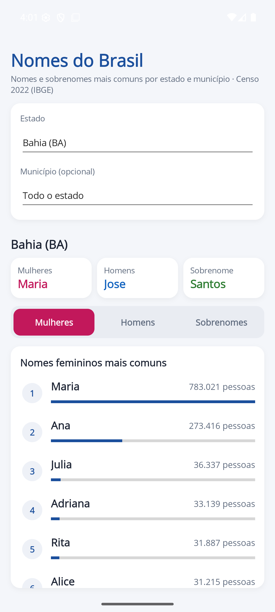
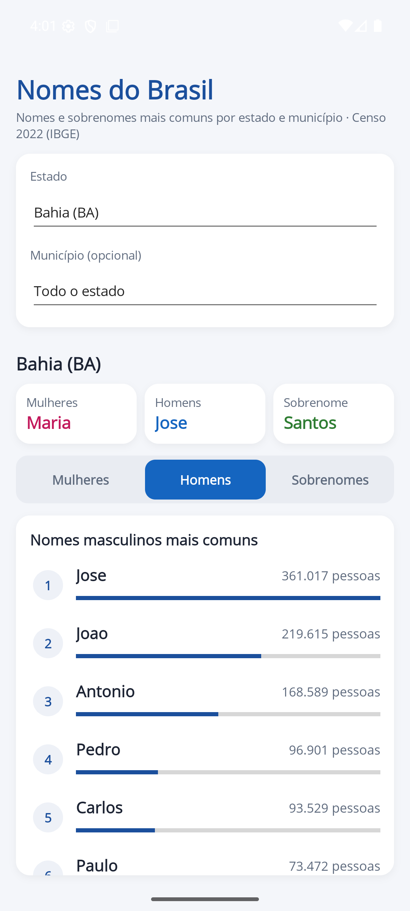
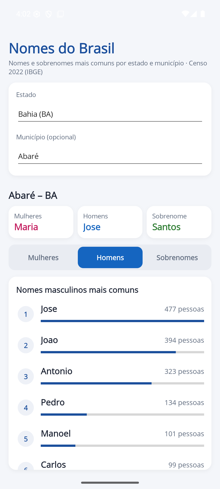
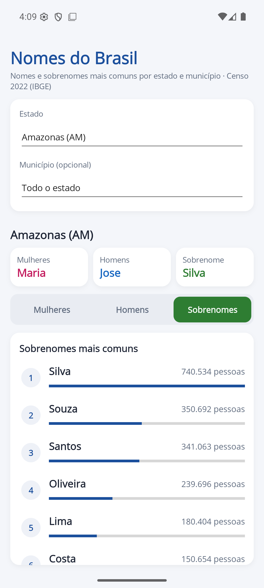
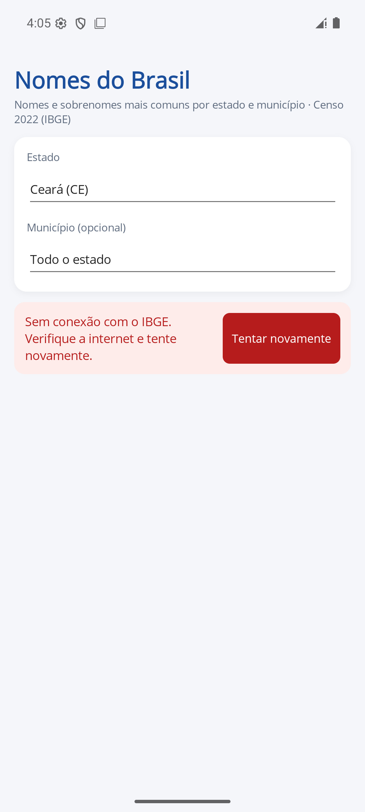

# Nomes do Brasil — IBGE Data Insights

Aplicativo **.NET MAUI (Android)** que consome **duas APIs públicas do IBGE em cadeia** para responder:
*"Quais são os nomes mais comuns de homens e mulheres — e os sobrenomes — em cada estado ou município brasileiro?"*

O usuário escolhe um **estado** (e, se quiser, um **município**) em seletores (Picker) e o app mostra na hora os
nomes femininos, masculinos e sobrenomes mais frequentes do **Censo 2022**.

## 👥 Integrantes

- Hygor Ferreira Barbosa
- Kauan Teodoro Lucio
- Elenara Caroline Xavier

## 📱 Telas

| Estado (Mulheres) | Estado (Homens) | Município | Sobrenomes | Sem internet |
|---|---|---|---|---|
|  |  |  |  |  |

## ⚙️ Como funciona (consulta encadeada)

```
Abrir o app ──► GET /api/v1/localidades/estados                      ──► Picker "Estado"
                        │ usuário escolhe um estado (id 29 = Bahia)
                        ├──► GET /api/v1/localidades/estados/29/municipios ──► Picker "Município"
                        └──► GET /api/v3/nomes/2022/localidade/29        ──► listas do estado
                                 │ usuário escolhe um município (id 2900207 = Abaré)
                                 └──► GET /api/v3/nomes/2022/localidade/2900207 ──► listas do município
```

1. **Seleção de localidade:** ao abrir, o app consome a API de Localidades e popula o seletor de estados.
2. **Consulta encadeada:** ao escolher um estado, o `id` dele dispara automaticamente a API de Nomes
   (e a lista de municípios daquele estado). Ao escolher um município, o `id` de 7 dígitos dispara a API de Nomes de novo.
   "Todo o estado" volta para os dados da UF.
3. **Exibição:** o JSON é separado em **Mulheres**, **Homens** e **Sobrenomes** — um resumo com o 1º de cada lista e
   abas com o ranking completo (posição, nome, quantidade de pessoas e barra proporcional ao 1º colocado).

APIs usadas ([documentação oficial](https://servicodados.ibge.gov.br/api/docs)):

| Uso | Endpoint |
|---|---|
| Estados | `https://servicodados.ibge.gov.br/api/v1/localidades/estados` |
| Municípios de um estado | `https://servicodados.ibge.gov.br/api/v1/localidades/estados/{UF}/municipios` (mesmo formato de `/localidades/municipios`, filtrado pela UF para não baixar os 5.570 municípios de uma vez) |
| Nomes por localidade | `https://servicodados.ibge.gov.br/api/v3/nomes/2022/localidade/{id_localidade}` |

## 🏗️ Arquitetura em camadas

```
src/IbgeNomes/
├── Models/                  ← Camada de Modelos: classes que mapeiam o JSON
│   ├── Estado.cs            (id, sigla, nome, regiao)
│   ├── Regiao.cs
│   ├── Municipio.cs         (id, nome)
│   ├── NomesLocalidade.cs   (localidade, mulheres, homens, sobrenomes)
│   └── NomeFrequencia.cs    (nome, frequencia)
├── Services/                ← Camada de Serviços / Integração: HttpClient + System.Text.Json
│   ├── Interfaces/
│   │   ├── ILocalidadesService.cs
│   │   └── INomesService.cs
│   ├── LocalidadesService.cs
│   ├── NomesService.cs
│   ├── IbgeHttp.cs          (GET + desserialização + tradução de erros)
│   └── IbgeApiException.cs
├── ViewModels/              ← Camada de Apresentação (lógica da tela, padrão MVVM)
│   ├── MainViewModel.cs     (encadeia as chamadas e prepara as listas)
│   └── RankingItem.cs       (linha já formatada para a lista)
├── Views/                   ← Camada de Apresentação (UI)
│   ├── MainPage.xaml        (Pickers, abas, CollectionView)
│   └── Converters.cs
└── MauiProgram.cs           ← injeção de dependência: liga as camadas
tests/IbgeNomes.Tests/       ← 19 testes automatizados (xUnit)
```

Regras que mantêm as camadas separadas:

- A **View** só faz *binding* com o ViewModel — não chama API nem conhece JSON.
- O **ViewModel** só conhece as **interfaces** dos serviços (recebidas por injeção de dependência), nunca o `HttpClient`.
- Os **Services** são os únicos que fazem HTTP. Qualquer falha (sem internet, timeout, erro 500, JSON inválido) vira
  `IbgeApiException` com mensagem pronta para o usuário, e a tela mostra um botão **"Tentar novamente"**.
- **Models**, **Services** e **ViewModels** não dependem de nada do MAUI — por isso o projeto de testes compila
  essas três camadas sozinhas e testa o encadeamento com serviços falsos.

Detalhes de implementação:

- **Cache em memória:** estados, municípios e nomes já consultados não são baixados de novo durante o uso.
- **Seleções rápidas:** se o usuário troca de estado antes da resposta chegar, a consulta anterior é cancelada
  (`CancellationToken`) e não sobrescreve a tela.
- **Localidade sem dados:** para um código sem dados o IBGE responde `null`; o app mostra um aviso em vez de quebrar.
- A API devolve os nomes **em minúsculas e sem acento** (`"joao"`); o app só ajusta a inicial (`Joao`).

## ▶️ Como executar

### Opção 1 — APK pronto (mais rápido)

1. Baixe `NomesDoBrasil-v1.1.apk` em **[Releases](../../releases/latest)**.
2. Arraste o arquivo para o emulador Android (ou copie para o celular e instale, permitindo "fontes desconhecidas").
3. Abra **Nomes do Brasil**. O emulador/celular precisa de **internet**.

### Opção 2 — Visual Studio 2026

1. Instale o **Visual Studio 2026** com a carga de trabalho **"Desenvolvimento de interface do usuário de aplicativo multiplataforma .NET"** (.NET MAUI).
2. Abra `IbgeNomes.sln`.
3. Escolha um emulador Android no botão de execução (ou crie um em *Ferramentas → Android → Gerenciador de Dispositivos*) e pressione **F5**.

### Opção 3 — Linha de comando

Pré-requisitos: **.NET SDK 10** ou superior e a carga de trabalho MAUI (`dotnet workload install maui-android`),
com um emulador Android já aberto.

```bash
git clone https://github.com/xeresgor/IbgeNomes.git
cd IbgeNomes

# rodar os testes (não precisa de emulador nem de internet)
dotnet test tests/IbgeNomes.Tests

# compilar, instalar e abrir no emulador
dotnet build src/IbgeNomes -f net10.0-android -t:Run
```

O projeto também compila como app de desktop Windows (alvo secundário; a entrega foi testada no Android):
`dotnet build src/IbgeNomes -f net10.0-windows10.0.19041.0 -t:Run`.

### Problemas comuns

| Sintoma | Causa provável | Solução |
|---|---|---|
| "Sem conexão com o IBGE" | Emulador sem internet | Verifique o Wi-Fi do emulador e toque em **Tentar novamente** |
| Seletor de estado vazio | A primeira consulta falhou | Toque em **Tentar novamente** |
| Erro `NETSDK1147` / workload | Carga de trabalho MAUI ausente | `dotnet workload install maui-android` |
| Emulador muito lento / "System UI isn't responding" | Aceleração de hardware desligada | Ative a *Plataforma do Hipervisor do Windows* e reinicie o PC |

## 🧪 Testes

`dotnet test tests/IbgeNomes.Tests` — 19 testes:

- **Serviços** (com um `HttpMessageHandler` falso, sem rede): URLs chamadas, desserialização, ordenação, cache,
  resposta `null`, erro HTTP 500, falha de rede e JSON inválido.
- **ViewModel:** abrir carrega os estados; escolher estado consulta a API de Nomes com o id da UF e carrega os municípios;
  escolher município consulta com o id de 7 dígitos; troca de abas; aviso de localidade sem dados; mensagem de erro; falha numa troca de estado não deixa na tela os nomes do estado anterior.

## 🛠️ Tecnologias

.NET 10 · .NET MAUI · CommunityToolkit.Mvvm · HttpClient · System.Text.Json · xUnit

Fonte dos dados: IBGE — Censo Demográfico 2022, [API de Nomes](https://servicodados.ibge.gov.br/api/docs/nomes?versao=3) e
[API de Localidades](https://servicodados.ibge.gov.br/api/docs/localidades).
